# 익명 라운지 · Anonymous Lounge

> 국비 AI 과정 수강생 30명을 위한 **익명 Q&A + 함께 고치는 위키 정리** 웹앱
> 기획 → 디자인 → 개발 → 배포 → 보안 점검 → 사용자 피드백 반영까지 혼자 진행한 프로젝트예요.

**▶ 체험판: https://anon-lounge.pages.dev/demo**
초대 코드 없이 모든 기능을 써볼 수 있어요. 체험판은 예시 데이터로만 움직이고, 써 본 글은 새로고침하면 사라져요.

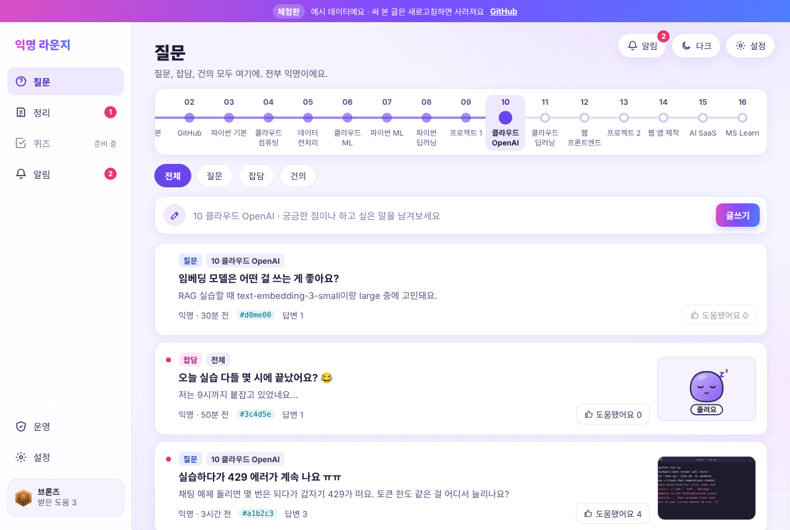

---

## 왜 만들었나

수업 중에 질문하기 망설여지는 순간이 많았어요. "이걸 나만 모르나?" 싶어서요.
Teams에는 익명 게시판이 없고, 질문과 답이 채팅에 흘러가 버려서 나중에 다시 찾기도 어려웠어요.

그래서 세 가지를 목표로 잡았어요.

1. **부담 없이 묻기**: 기본은 익명이고, 원하는 사람만 실명으로 써요.
2. **답이 쌓이기**: 과목별로 모이고, "도움됐어요"로 좋은 답이 드러나요.
3. **같이 정리하기**: 수업 내용을 나무위키처럼 여럿이 고치고 더해요.

## 주요 기능

| 질문·답변 | 함께 고치는 정리 (위키) |
|---|---|
| 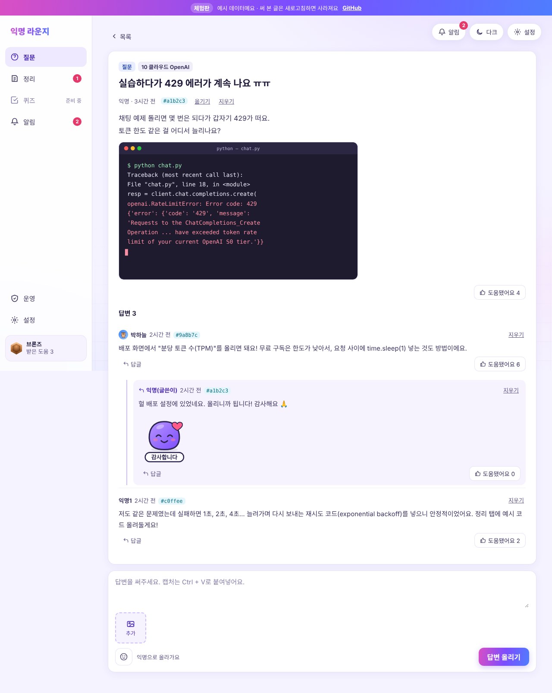 | 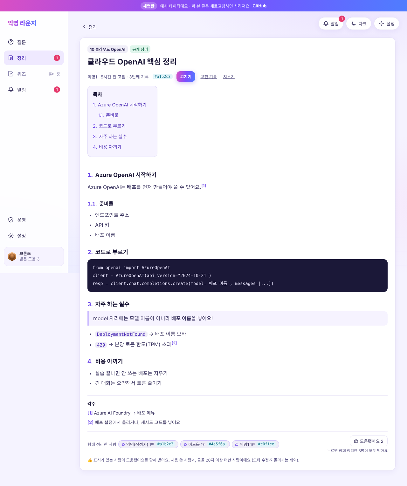 |

**질문 탭**
- 16개 과목 타임라인에서 과목별 질문을 봐요. 안 읽은 글은 숫자 배지로 표시돼요.
- 말머리는 질문, 잡담, 건의예요. 잡담과 건의는 과목 구분 없이 전체 공용이에요.
- 글 안에서는 같은 사람이 같은 번호로 보여요(에브리타임 방식). 익명1, 익명2, 익명(글쓴이)처럼요.
- 답변과 대댓글을 달 수 있어요. 대댓글은 한 단계까지예요.
- 캡처는 **Ctrl+V로 붙여넣기**만 하면 브라우저에서 줄여서 올라가요. 한 글에 20장까지 올릴 수 있고, 크게 보기에서 밀어서 넘겨요.
- 이모지, GIF(GIPHY), **직접 그린 캐릭터 스티커 16종**을 쓸 수 있어요.
- 내 글에 답변이 달리면 알림이 와요.

**정리 탭 (위키)**
- 나만 보는 노트를 쓰다가, 원하면 **공개 정리**로 올려 모두가 함께 고쳐요.
- 마크다운을 지원해요. 목차와 번호가 자동으로 붙고, 각주(`[*설명]`), 코드 블록, 이미지 붙여넣기도 돼요.
- **고친 기록**이 모두 남아요. 줄 단위로 바뀐 부분을 비교하고 예전 버전으로 되돌릴 수 있어요.
- 두 사람이 **동시에 고치면 충돌을 감지**해요. 쓰던 글은 지켜지고, 덮어쓸지 최신 내용을 불러올지 고를 수 있어요.
- 저장 전 내용은 이 기기에 임시 저장돼요.
- "도움됐어요"는 처음 쓴 사람뿐 아니라 **20자 이상 더한 기여자 모두**가 받아요. 오타만 고친 건 제외예요.

| 고친 기록 비교 | 정리 쓰기 (실시간 미리보기) |
|---|---|
| 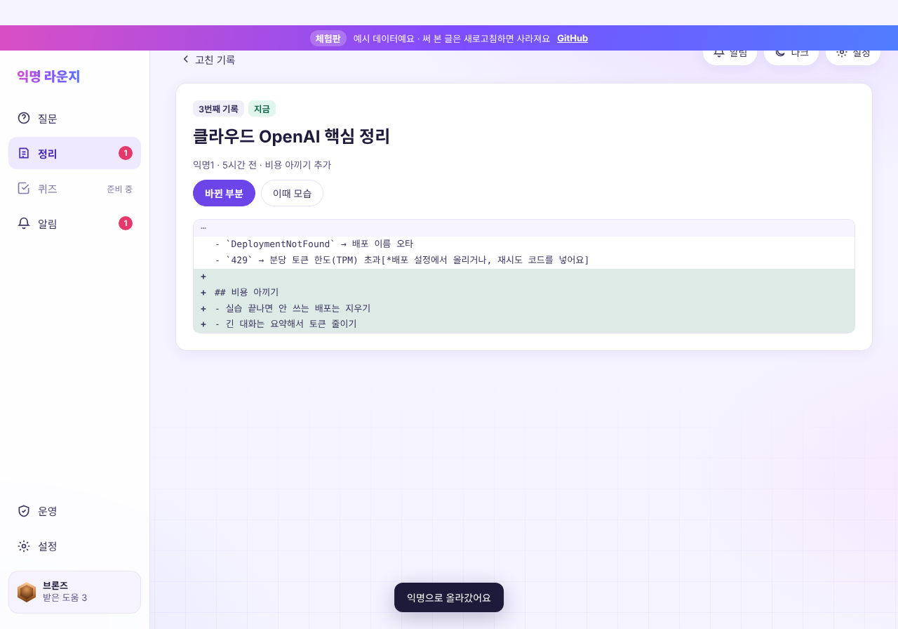 | 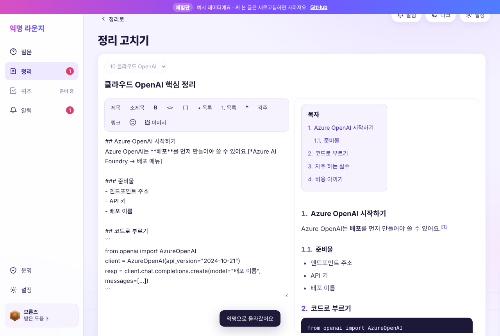 |

**그 밖에**
- **티어:** 받은 도움 수에 따라 브론즈 → 실버 → 골드 → 플래티넘 → 다이아로 올라가요.
- **실명 사용자 프로필:** 사진이나 이모지, 소개, 관심 태그, 링크를 넣을 수 있고, 쓴 글 기록은 비공개로 할 수 있어요.
- **라이트/다크 모드:** 다크는 과정 포스터의 네온 퍼플 톤이에요.
- **모바일 대응:** 아래 탭 바가 생기고, 글쓰기 칸이 화면 너비에 맞춰져요.
- **운영 화면:** 소유자와 운영자를 나눠요. 글쓰기 제한, 사용자별 글·답변 보기, 사이트 열고 닫기를 할 수 있어요.

| 이모지·GIF·스티커 | 다크 모드 |
|---|---|
| 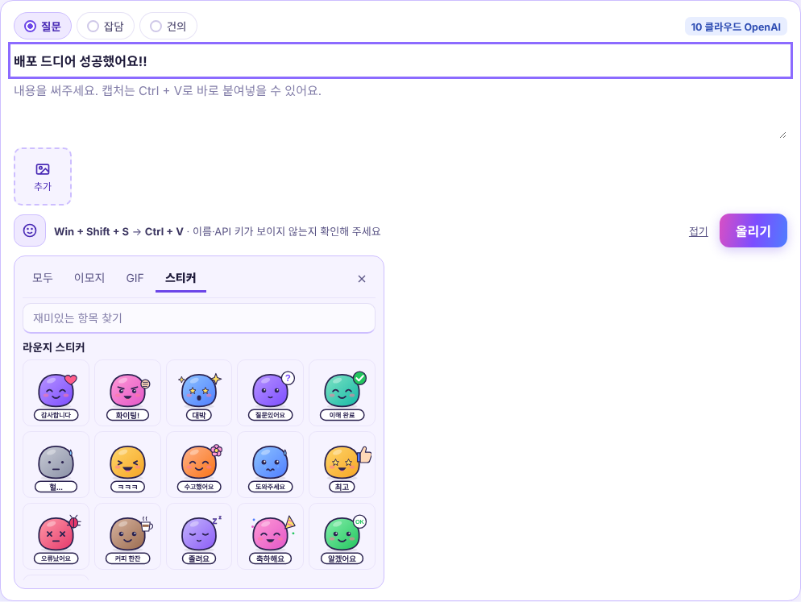 | 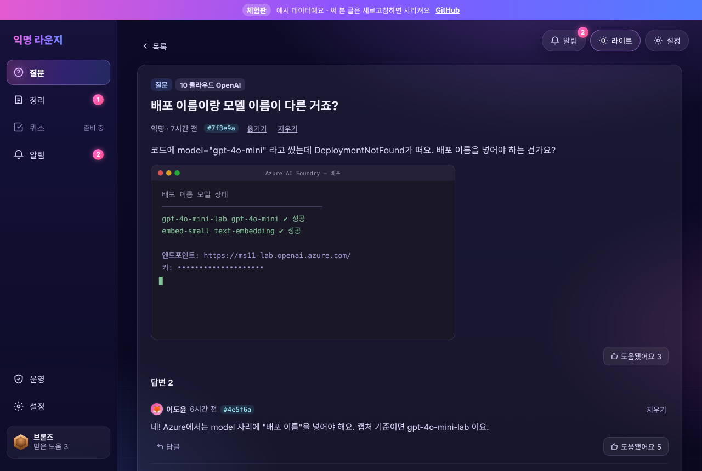 |

| 폰 | 폰 · 정리 | 운영 종료 화면 |
|---|---|---|
| 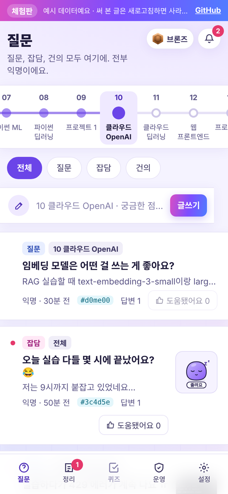 | 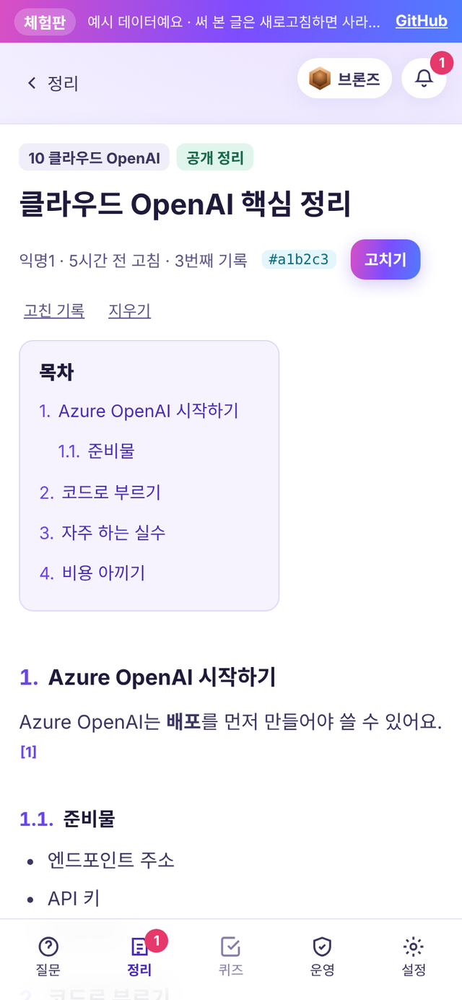 | 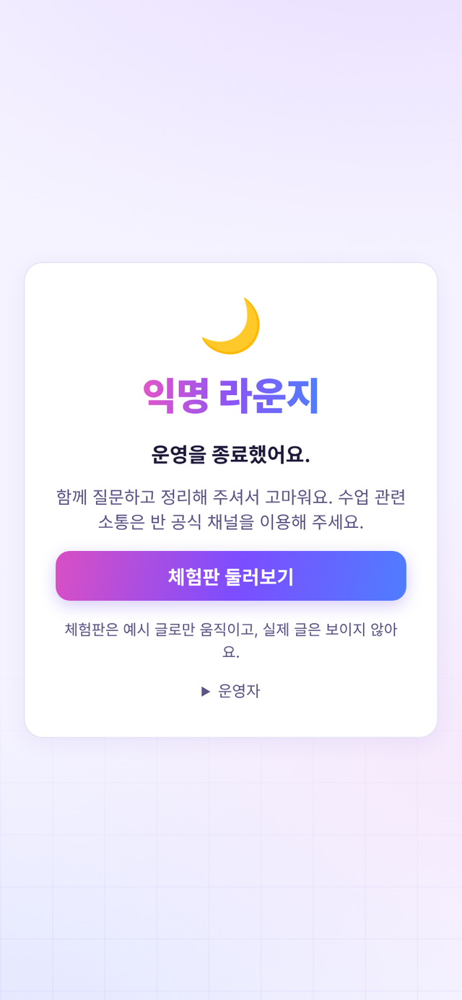 |

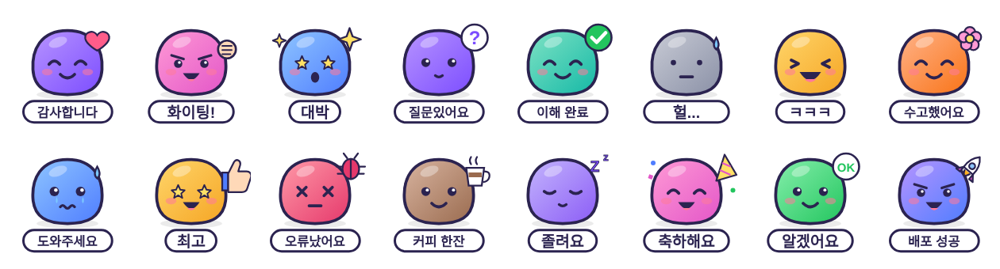

## 설계하면서 고민한 것

### 1. 익명인데 계정은 이어져야 한다
학교나 회사 계정 로그인(Microsoft)은 **일부러 쓰지 않았어요**. 수료 후 노트북과 계정을 반납하면 접속할 길이 사라지기 때문이에요.
- 초대 코드로 들어오면 무작위 ID가 생겨요. 서버에는 **세션 토큰의 해시만** 저장해요.
- **복구 코드:** 16자, 80비트예요. 해시로만 저장하고, 다른 기기나 반납 후 개인 폰에서 같은 계정으로 들어올 수 있어요.
- **패스키(WebAuthn):** 라이브러리 없이 **Web Crypto로 직접 구현**했어요. CBOR 디코딩, COSE→JWK 변환, ES256/RS256 서명 검증, 서명 카운터 검사까지 들어 있어요.

### 2. 익명성을 지키는 작은 결정들
- 운영자에게도 실명이 아니라 `#a1b2c3` 같은 번호만 보여요.
- 프로필 주소는 사용자 ID가 아니라 **별도의 무작위 주소**예요.
- 프로필에는 **실명으로 쓴 글만** 나와요. 티어는 익명 활동량이 드러날 수 있어서 프로필에서 숨겨요.
- 나만 보기 노트는 운영자도 볼 수 없어요.

### 3. 보안
- **CSRF:** 쓰기 요청은 `Origin`과 `Sec-Fetch-Site`를 검사해요.
- **무차별 대입 방지:** 같은 IP에서 10분에 30번 실패하면 막아요. IP는 해시로만 저장해요.
- **업로드 검사:** 확장자가 아니라 **파일 앞부분(매직 바이트)**으로 확인해요. SVG는 막아요. 이미지 응답에는 `sandbox` CSP를 붙여요.
- **XSS 방지:** 화면은 `innerHTML` 없이 DOM API로만 그려요. 마크다운 렌더러도 직접 만들었어요. 링크는 http(s)만, 이미지는 자기 서버 주소만 허용해요.
- **CSP 등 보안 헤더:** 외부 스크립트는 실행되지 않아요.
- **Teams 탭 안에서 로그인 유지:** 쿠키를 `SameSite=None; Secure; Partitioned`(CHIPS)로 저장해요. 안전성은 CSRF 검사로 보완해요.

### 4. 운영하면서 바뀌는 데이터베이스
배포 중에 표와 칸이 계속 늘어났는데, 매번 SQL을 손으로 돌리지 않도록 **서버가 처음 뜰 때 알아서 보강**해요(`ensureSchema`). 예전 쿠키 세션 이전, 잡담 전체 통합, 기여 글자 수 재계산 같은 **데이터 이전도 자동**이에요. 테스트는 실제 예전 DB 사본으로 했어요.

### 5. 비용 0원
- Cloudflare Pages + Pages Functions + D1(SQLite)로 돌아가요.
- 빌드 도구 없이 순수 JavaScript(ES 모듈)예요.
- 이미지는 브라우저에서 400KB 이하로 줄이고, 20장도 **한 장씩 따로 올려서** 무료 요금제의 CPU 한도(10ms)를 넘지 않게 했어요.
- GIPHY 무료 키는 시간당 100회라 서버에서 1시간 캐시해요.

## 기술 스택과 구조

```
브라우저 (public/)                      Cloudflare
┌──────────────────────────┐          ┌───────────────────────────────┐
│ app.js  화면·라우팅       │  /api/*  │ Pages Functions               │
│  - 마크다운·diff 직접 구현 │ ───────▶ │  functions/api/[[path]].js    │
│  - 이미지 압축 (canvas)   │          │  functions/_lib/              │
│ style.css 라이트/다크 변수 │          │   webauthn.js  패스키 검증     │
│ demo.js  체험판 가짜 서버  │          │   notes.js     위키·기록       │
└──────────────────────────┘          │   profile.js   프로필          │
                                      │   media.js     GIF·스티커      │
                                      │            │                  │
                                      │            ▼                  │
                                      │      D1 (SQLite)              │
                                      └───────────────────────────────┘
```

- **프론트:** Vanilla JS, CSS 변수 테마, 반응형
- **서버:** Cloudflare Pages Functions(Workers 런타임), D1
- **인증:** 초대 코드, 해시 세션, 복구 코드, WebAuthn 패스키
- **테스트:** Playwright 엔드투엔드 테스트 15개 묶음, **232개 검사** (`tests/`, `bash tests/run_all.sh`). 가상 인증기로 패스키 등록·로그인, 다른 사이트 iframe(Teams 흉내) 안 로그인, 동시 편집 충돌, 예전 DB 이전까지 확인해요.
- **로컬 서버:** `dev/server.mjs`는 의존성 없이 Node 22 내장 SQLite로 D1을 흉내 내요.

## 체험판은 어떻게 만들었나
실제 사이트의 데이터는 수강생의 글이라 보여줄 수 없어요. 그래서 `demo.js`가 **브라우저 안에서 서버처럼 대답**해요. `fetch('/api/…')`를 가로채서 예시 데이터로 응답하는 방식이에요. 화면 코드는 실제와 똑같고, 진짜 서버로는 요청이 하나도 나가지 않아요. 이것도 테스트로 확인했어요.

## 회고: 운영을 멈춘 이유
Teams 채널에 붙이기 전에 과정 운영국에 승인을 요청했어요. 답은 이랬어요.

> 익명 커뮤니티 특성상 비방이나 개인정보 침해가 생겨도 운영국이 사실관계를 확인하거나 수강생을 보호하기 어렵다.

맞는 지적이었어요. 저는 "익명이라 편하게 묻는 것"에 집중했지만, 운영 책임을 질 쪽의 시선(**문제가 생기면 누가, 어떻게 조치하나**)은 늦게 고려했어요. 그래서 공식 운영은 하지 않기로 하고, 사이트는 **운영 종료 모드**로 닫아 두었어요. 소유자만 들어갈 수 있고, 데이터는 보존돼요.

배운 점이에요.
- **이해관계자 승인은 만들기 전에.** 기능보다 먼저 "운영 주체와 책임"을 정했어야 했어요.
- 익명 서비스에는 **신고, 작성자 확인 절차, 이용 규칙 동의** 같은 안전장치가 기능만큼 중요해요.
- 그래도 실제 사용자 피드백을 받으며 30번 넘게 고쳐 본 경험이 남았어요. 이미지 장수, 대댓글, 이모지 창 위치, 정리 기여 보상 같은 것들이요.

## 직접 띄워 보기

**내 컴퓨터에서** (Node.js 22 이상, 설치할 것 없음)
```
node dev/server.mjs
```
- http://localhost:8788: 초대 코드 `test-code`, 운영자 코드 `admin-code`
- http://localhost:8788/demo: 체험판

**Cloudflare에 배포하기**
1. **Workers & Pages → Pages → Git에 연결**에서 이 저장소를 골라요. 빌드 명령은 비우고, 출력 폴더는 `public`으로 해요.
2. **D1 데이터베이스**를 만들고 Console에서 `schema.sql`을 실행해요. 그 뒤 칸 추가는 서버가 알아서 해요.
3. Pages **Settings**에서 아래를 넣고 재배포해요.
   - Bindings → D1: 변수 이름 `DB`
   - Secrets
     - `INVITE_CODE`: 수강생용 초대 코드
     - `ADMIN_CODE`: 소유자 코드. 처음 들어온 사람이 소유자가 되고, 이후에는 소유자 계정 되찾기용이에요. 길게 정하세요.
     - `GIPHY_API_KEY`: 선택이에요. GIF를 쓰려면 https://developers.giphy.com 에서 API 키를 만들어 넣어요.
4. **Teams에 붙이기:** 채널 위 **+ → 웹 사이트**에 주소를 넣어요. 운영 기관의 승인을 먼저 받으세요!

## 폴더 구조
```
public/                 화면
  index.html, app.js, style.css, theme.js
  demo.html, demo.js    체험판 (브라우저 안 가짜 서버)
  stickers/             직접 그린 캐릭터 스티커 (SVG)
  _headers              보안 헤더 (CSP 등)
functions/api/[[path]].js   서버 API 라우터
functions/_lib/         webauthn.js · notes.js · profile.js · media.js
schema.sql              새로 설치할 때의 데이터베이스
dev/server.mjs          로컬 서버 (D1 대신 node:sqlite)
docs/screenshots/       README 화면
```

---
만든 사람: 김성희 ([@seonhg](https://github.com/seonhg)) · AI와 함께 개발 (Claude)
